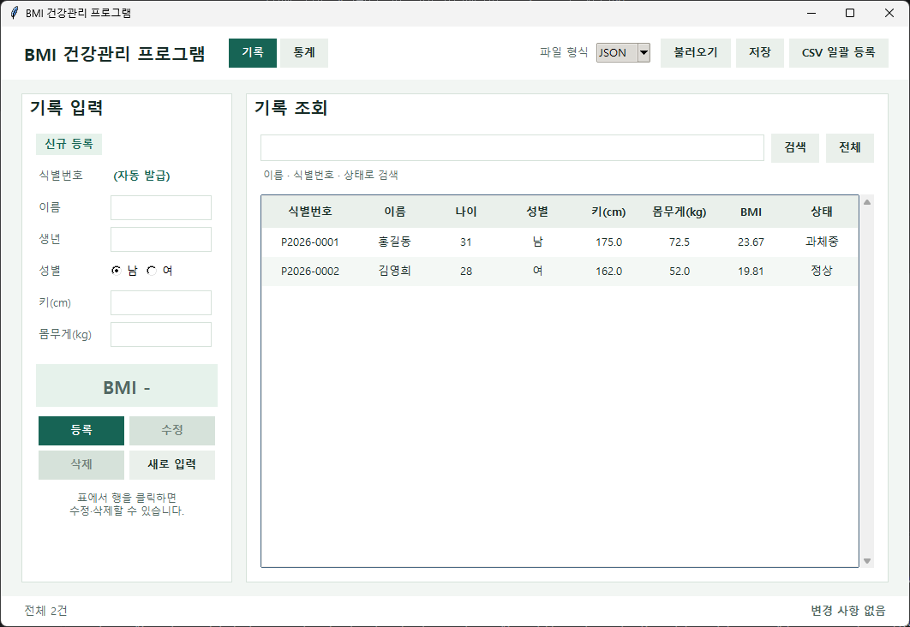

# BMI 건강관리 프로그램

2026-2 프로그래밍 II 지정 개인 프로젝트 · 202611814 권순욱

여러 사람의 키와 몸무게를 기록하고, BMI(체질량지수)와 비만도를 자동으로 계산해 관리하는 데스크톱 프로그램이다. 창 하나에서 기록을 등록·조회·수정·삭제하고, 통계 화면에서 전체 현황을 본다. 데이터는 JSON·CSV·TXT·PKL 네 가지 파일로 저장하며, Python 표준 라이브러리(tkinter)만 사용한다.



---

## 누가 쓰는 프로그램인가

- **사용자**: 여러 사람의 신체 정보를 모아 관리하는 건강관리 담당 직원과 관리자. 예를 들어 학교 보건실, 회사의 건강관리 담당, 운동 시설의 회원 관리.
- **사용 형태**: PC 한 대에서 혼자 쓰는 단독형(stand-alone) 프로그램이다. 로그인이나 인터넷 연결이 필요 없고, 데이터는 `data` 폴더의 파일에 저장된다.
- **주의**: BMI 판정은 키와 몸무게만으로 계산한 참고 지표이며 의학적 진단이 아니다.

---

## 실행 방법

### 준비

- Windows PC
- Python 3 (개발에 사용한 버전: 3.14). tkinter는 Python에 기본으로 들어 있어서 따로 설치할 라이브러리가 없다.

### 실행

저장소 폴더(그 안에 `health_management_project` 폴더가 있는 위치)에서 터미널을 열고 실행한다.

```
python health_management_project/main.py
```

VS Code에서는 저장소 폴더를 연 상태에서 `main.py`를 열고 실행(▶) 버튼을 누른다.

> 데이터 파일 경로가 저장소 폴더를 기준으로 적혀 있다. 다른 위치에서 실행하면 시작할 때 "불러오기 실패" 경고가 뜨고 빈 목록으로 시작한다.

### 처음 써 보기

1. 실행하면 `data/health_data.json`의 기록을 자동으로 불러와 표에 보여 준다.
2. 왼쪽 "기록 입력"에 이름·생년·성별·키·몸무게를 넣고 [등록]을 누른다. 식별번호가 자동으로 붙는다.
3. 표에서 방금 등록한 행을 클릭한다. 왼쪽 폼이 채워지고 "수정 모드"로 바뀐다.
4. 몸무게를 바꾸고 [수정]을 누른다. BMI와 상태가 다시 계산된다.
5. 검색칸에 `정상`을 입력하고 [검색]을 누른다. 정상인 사람만 보인다. [전체]를 누르면 다시 모두 보인다.
6. 맨 위 [통계] 탭에서 평균과 상태별 인원을 본다. [기록] 탭을 누르면 돌아온다.
7. [저장]을 누르고 "예"를 고른다. 프로그램을 껐다 켜도 기록이 남아 있다.

---

## 화면 구성

| 위치 | 내용 |
|---|---|
| 맨 위 줄 | 제목, [기록]·[통계] 탭, 파일 형식 선택(JSON·CSV·TXT·PKL), [불러오기] [저장] [CSV 일괄 등록] |
| 기록 화면 왼쪽 "기록 입력" | 모드 표시(신규 등록 / 수정 모드), 식별번호, 이름·생년·성별·키·몸무게 입력칸, BMI 결과, [등록] [수정] [삭제] [새로 입력] |
| 기록 화면 오른쪽 "기록 조회" | 검색칸과 [검색] [전체], 기록 표(식별번호, 이름, 나이, 성별, 키, 몸무게, BMI, 상태) |
| 통계 화면 | 총 인원, 평균 키·몸무게·BMI와 표준편차, BMI 상태별 인원 막대 차트 |
| 맨 아래 상태 표시줄 | 왼쪽: 전체 건수와 검색 결과 건수 / 오른쪽: 저장하지 않은 변경이 있는지 |

---

## 기능

### 등록

- 이름, 생년, 성별, 키, 몸무게를 입력하고 [등록]을 누른다. 입력칸에서 엔터를 눌러도 된다.
- 식별번호를 자동으로 발급한다. 형식은 `P2026-0001`이고, 지금 목록에서 가장 큰 번호에 1을 더한다.
- 이름·생년·성별이 모두 같은 사람이 이미 있으면 등록하지 않는다(중복 체크).
- BMI와 비만도는 입력한 키·몸무게로 자동 계산한다.

### 조회와 검색

- 등록된 기록 전체를 표로 보여 준다. 나이는 올해에서 생년을 빼서 계산한다.
- 검색어로 이름 일부, 식별번호 전체, 상태(저체중·정상·과체중·비만)를 찾는다. 검색칸에서 엔터를 눌러도 된다.
- 상태 표시줄에 "검색 결과 4건 / 전체 7건"처럼 건수가 나온다.

### 수정

- 표에서 행을 클릭하면 그 사람의 정보가 왼쪽 폼에 채워지고 "수정 모드"가 된다.
- 키와 몸무게만 수정할 수 있다. [수정]을 누르면 BMI와 상태를 다시 계산한다.
- 이름·생년·성별은 중복 체크 기준이라 수정 모드에서 잠긴다. 바꿔야 하면 삭제한 뒤 다시 등록한다.
- [새로 입력]을 누르면 폼을 비우고 신규 등록으로 돌아간다.

### 삭제

- 행을 선택하고 [삭제]를 누르면 확인 창이 뜬다. "예"를 고르면 목록에서 지운다.

### 통계

- [통계] 탭에서 총 인원, 평균 키·몸무게·BMI와 각각의 표준편차, BMI 상태별 인원과 비율을 본다.
- 검색 중이어도 통계는 항상 전체 기록으로 계산한다.

### 파일

- **불러오기**: 파일 형식을 고르고 [불러오기]를 누르면 그 파일의 기록으로 목록을 바꾼다. 프로그램을 시작할 때는 JSON 파일을 자동으로 불러온다.
- **저장**: [저장]을 누르고 "예"를 고르면 JSON·CSV·TXT·PKL 네 파일에 모두 저장한다. 파일 형식 선택은 불러오기에만 쓰인다.
- **CSV 일괄 등록**: 열 이름이 `name, birth_year, gender, height, weight`인 CSV 파일을 골라 여러 명을 한 번에 등록한다. 형식이 틀린 줄과 이미 등록된 사람은 건너뛰고, 몇 건을 추가하고 제외했는지 알려 준다.
- **저장 안내**: 등록·수정·삭제 후 아직 저장하지 않았으면 상태 표시줄에 빨간 글씨로 알리고 [저장] 버튼이 강조된다. 이 상태에서 [불러오기]를 누르면 지금 목록이 바뀌기 전에 한 번 묻는다.

### 오류 안내

- 잘못된 값을 넣어도 프로그램이 멈추지 않고 경고창으로 알려 준다. 경고를 닫고 그 칸만 고치면 된다.
- 데이터 파일이 없거나 손상되어도 멈추지 않는다. 불러오기에 실패하면 경고하고 지금 목록은 그대로 두며, 저장에 실패하면 오류창으로 알려 준다.
- 등록·수정·삭제·저장·불러오기가 끝나면 완료 알림창이 뜬다.

---

## 동작 흐름

### 모듈 구조

```
main.py
 └─ HealthGUI             modules/health_gui.py    모듈3: 화면, 버튼·클릭 처리
     ├─ HealthManager     modules/health_logic.py  모듈2: 기록 목록 관리, CRUD, 통계
     │   └─ HealthRecord  modules/health_db.py     모듈1: 기록 1건, BMI 계산
     └─ HealthDB          modules/health_db.py     모듈1: 파일 4종 읽기·쓰기
         └─ data/health_data.json · .csv · .txt · .pkl
```

- 모듈마다 맡은 일만 한다. `HealthGUI`는 기록을 직접 고치지 않고 `HealthManager`의 메소드를 부른다.
- `HealthManager` 클래스는 화면 출력과 파일을 다루지 않고, 결과만 돌려준다(return).

### 프로그램 시작

1. `main.py`가 창(`tk.Tk()`)을 만들고 `HealthGUI(root)`를 실행한다.
2. `HealthGUI.__init__`이 `HealthDB`와 `HealthManager`를 만들고 화면(맨 위 줄, 입력 폼, 표, 통계 화면, 상태 표시줄)을 만든다.
3. `on_load(quiet=True)`로 JSON 파일을 읽어 표와 통계를 채운다.
4. `root.mainloop()`가 사용자의 클릭과 입력을 기다린다.

### 버튼을 누르면

| 사용자 동작 | 처리 순서 |
|---|---|
| [등록] 또는 엔터 | `on_add` → `read_form`(입력 검사) → `add_record`(중복 검사 → `generate_id` → `HealthRecord` 생성, 이때 BMI 계산) → `refresh` |
| 표에서 행 클릭 | `<<TreeviewSelect>>` 이벤트 → `on_select` → `find_by_id` → `fill_form` → `set_mode("selected")` |
| [수정] 또는 엔터 | `on_update` → `read_positive`(키·몸무게 검사) → `update_record`(안에서 `calc_bmi`) → `refresh` → `fill_form` |
| [삭제] | `on_delete` → 확인 창 → `delete_record` → `clear_form` → `refresh` |
| [검색] 또는 엔터 | `on_search` → `search(검색어)` → `refresh(검색 결과)` |
| [통계] / [기록] 탭 | `show_stats` / `show_records`: 한쪽 화면을 숨기고(`grid_remove`) 다른 쪽을 보여 준다 |
| [저장] | `on_save` → 확인 창 → `to_dict_list` → `HealthDB.save_data`(파일 4개, 성공 `True` / 실패 `False`) → 실패면 오류창 |
| [불러오기] | `on_load` → (저장 안 한 변경이 있으면 확인) → `HealthDB.load_data`(읽지 못한 파일은 빈 리스트) → 고른 형식만 `HealthRecord`로 변환 → 0건이면 경고하고 중단 → `set_records` → `refresh` |
| [CSV 일괄 등록] | `on_import_csv` → 파일 선택 → 줄마다 `add_record` → `refresh` |

- 기록이 바뀌는 동작은 모두 마지막에 `refresh`를 부른다. `refresh` 하나가 표, 통계(`update_stats` → `get_statistics` → `draw_chart`), 상태 표시줄을 함께 다시 그린다.
- 저장 여부는 `self.changed`에 기억한다. 등록·수정·삭제·일괄 등록 뒤에는 `set_changed(True)`, 저장·불러오기 뒤에는 `set_changed(False)`를 부른다.

---

## 데이터 규칙

### 기록 항목

| 항목 | 키 | 형식 | 예 |
|---|---|---|---|
| 식별번호 | `id` | 문자열 | `P2026-0001` |
| 이름 | `name` | 문자열 | `홍길동` |
| 생년 | `birth_year` | 정수 | `1995` |
| 성별 | `gender` | 문자열 | `남` |
| 키(cm) | `height` | 실수 | `175.0` |
| 몸무게(kg) | `weight` | 실수 | `72.5` |
| BMI | `bmi` | 실수, 자동 계산 | `23.67` |
| 비만도 | `status` | 문자열, 자동 판정 | `과체중` |

### BMI 계산과 판정

BMI = 몸무게(kg) ÷ 키(m)², 소수 둘째 자리까지 반올림한다.

| BMI | 판정 |
|---|---|
| 18.5 미만 | 저체중 |
| 18.5 이상 23 미만 | 정상 |
| 23 이상 25 미만 | 과체중 |
| 25 이상 | 비만 |

통계의 표준편차는 전체 기록을 모집단으로 보고 계산한다(`statistics.pstdev`).

### 입력 규칙

| 항목 | 규칙 |
|---|---|
| 이름 | 비워 둘 수 없다 |
| 생년 | 정수, 1900년부터 올해까지 |
| 성별 | 남 / 여 중에서 고른다 |
| 키, 몸무게 | 숫자, 0보다 크고 500 이하 |

### 저장 파일 (`data` 폴더)

| 파일 | 저장 모양 |
|---|---|
| `health_data.json` | 기록 하나를 딕셔너리 하나로, 그 목록을 저장 |
| `health_data.csv` | 첫 줄에 열 이름, 그 아래 한 줄에 기록 하나 (엑셀로 열 수 있다) |
| `health_data.txt` | 한 줄에 기록 하나, 값을 쉼표로 구분 |
| `health_data.pkl` | 딕셔너리 목록을 pickle로 저장 (사람이 읽을 수 없는 이진 파일) |

CSV와 TXT의 한 줄은 이런 모양이다.

```
P2026-0001,홍길동,1995,남,175.0,72.5,23.67,과체중
```

---

## 알아 둘 점

- **창을 닫을 때 저장 여부를 묻지 않는다.** [저장]을 누르지 않고 닫으면 그동안의 변경은 사라진다. 상태 표시줄 오른쪽에서 저장할 내용이 남았는지 확인한다.
- 수정과 삭제도 [저장]을 눌러야 파일에 반영된다.
- 모듈1의 `load_data`는 파일마다 따로 예외를 처리한다. 없거나 손상된 파일은 빈 목록으로 돌려주므로, 파일 하나가 없어도 나머지 형식은 불러올 수 있다. 처음이라 파일이 하나도 없으면 기록을 등록한 뒤 [저장]하면 네 파일이 만들어진다.
- 저장은 네 파일을 차례로 쓰다가 중간에 실패하면 멈춘다. 이때 앞에서 저장한 파일은 이미 바뀌었을 수 있으니, 원인을 해결하고 다시 [저장]한다.
- 파일 경로가 Windows 방식(`\`)이고 저장소 폴더를 기준으로 적혀 있다. 그래서 Windows에서, 저장소 폴더에서 실행해야 한다.
- 식별번호의 연도 부분은 `2026`으로 고정되어 있다.
- 나이는 올해에서 생년을 뺀 값이라 생일이 지났는지는 반영하지 않는다.

### 문제 해결

| 증상 | 원인과 해결 |
|---|---|
| 시작하자마자 "불러오기 실패" | 실행 위치가 저장소 폴더가 아니거나, JSON 파일이 없거나 손상되었거나 비어 있다. 저장소 폴더에서 실행하고, 다른 형식을 골라 [불러오기]하거나 기록을 등록한 뒤 [저장]한다. |
| TXT 형식으로 불러오면 "올바른 형식이 아닙니다" | TXT 한 줄에 값이 8개(식별번호부터 비만도까지)가 아니면 읽지 못한다. 다른 형식으로 불러온 뒤 [저장]하면 TXT도 맞는 형식으로 다시 저장된다. |
| "파일 저장 실패" | 저장할 파일이 엑셀 같은 다른 프로그램에서 열려 있으면 Windows가 파일을 잠근다. 그 프로그램을 닫고 다시 [저장]한다. 쓰기 권한이 없는 폴더에서 실행해도 생긴다. |
| CSV 일괄 등록에서 모든 줄이 제외됨 | 첫 줄 열 이름이 `name, birth_year, gender, height, weight`인지 확인한다. 엑셀의 "CSV UTF-8" 저장은 파일 맨 앞에 보이지 않는 문자(BOM)를 붙여서 첫 열 이름을 찾지 못한다. VS Code나 메모장에서 UTF-8로 저장한 파일을 쓴다. |
| CSV 일괄 등록에서 "CSV 파일을 읽지 못했습니다" | 파일이 UTF-8이 아니다. 엑셀의 기본 "CSV" 저장은 한글 Windows에서 UTF-8이 아니므로, UTF-8로 다시 저장한다. |

---

## 폴더 구조

```
health_management_project/
├── README.md              이 문서
├── main.py                실행 진입점: GUI를 띄운다
├── modules/
│   ├── __init__.py
│   ├── health_db.py       모듈1: HealthRecord(기록 1건, BMI 계산), HealthDB(파일 입출력)
│   ├── health_logic.py    모듈2: HealthManager(목록 관리, CRUD, 통계), 콘솔 테스트용 TUI
│   └── health_gui.py      모듈3: HealthGUI(Tkinter 화면, 이벤트 처리)
├── data/                  저장 파일 4종 (json, csv, txt, pkl)
└── assets/                실행 화면 캡처 (result_screenshot.png)
```

---

## 요구사항 대응

| 요구사항 | 구현 위치 (GUI / 로직) |
|---|---|
| FR-01 등록, 중복 체크, 식별번호 자동 생성 | `on_add` / `add_record`, `is_duplicate`, `generate_id` |
| FR-01 (선택) CSV 파일 일괄 등록 | `on_import_csv` / `add_record` |
| FR-02 전체 목록(표), 검색, 상세 보기 | `refresh`, `on_search`, `on_select` → `fill_form` / `get_all`, `search`, `find_by_id` |
| FR-03 수정, BMI 자동 재계산 | `on_update` / `update_record` → `calc_bmi` |
| FR-04 삭제 (저장하면 파일에서도 삭제) | `on_delete`, `on_save` / `delete_record` |
| FR-05 통계 산출과 시각화 | `update_stats`, `draw_chart` / `get_statistics` |
| 입력 값 검증 (문자·0 이하 입력 시 경고) | `read_form`, `read_positive` |
| 파일 입출력 예외 처리 (파일 부재·손상 시 기본값 반환) | `HealthDB.load_data`(파일마다 try-except, 실패하면 빈 리스트), `HealthDB.save_data`(실패하면 `False`) / GUI·TUI는 결과를 보고 경고, `on_import_csv`는 자체 try-except |
| 작업 완료 알림 (`messagebox.showinfo`) | 등록·수정·삭제·저장·불러오기·일괄 등록 |
| 표 행 클릭 시 입력 폼 자동 채움 | `<<TreeviewSelect>>` → `on_select` |
| 역할 분리 (데이터 / 로직 / 화면) | `health_db.py` / `health_logic.py` / `health_gui.py` |
| tkinter만 사용 | 외부 라이브러리 설치 없음 |

---

## 개발 환경과 과정

- **언어와 라이브러리**: Python 3.14, tkinter, 표준 라이브러리(json, csv, pickle, statistics, datetime)
- **도구**: VS Code, Git, GitHub
- **과정**: 3단계 모듈식으로 개발했다. 11주차 모듈1(데이터 구조와 파일 처리) → 12주차 모듈2(로직, 콘솔 TUI로 테스트) → 13주차 모듈3(GUI). 모듈2부터는 브랜치를 만들어 작업하고 Pull Request로 main에 합쳤다.

---

## AI 사용

과제 규칙에 따라, AI 도움을 받은 파일에는 맨 위 `[AI 사용 주석]`에 AI 종류, 사용 목적, 사용한 프롬프트, 사용한 사람, 날짜를 적었다.

| 파일 | AI | 사용 내용 |
|---|---|---|
| `main.py` | Claude | 실행 진입점 작성 방향과 힌트 |
| `modules/health_db.py` | Claude | 파일 부재·손상 예외 처리 (`load_data`, `save_data`) |
| `modules/health_logic.py` | Claude | 모듈2 설계 방향, 줄 단위 작성 힌트, 독스트링 초안, 예외 처리에 맞춘 TUI 수정 |
| `modules/health_gui.py` | Claude, OpenAI Codex | Claude: GUI 기획과 작성 힌트, 화면 꾸미기, 사용성 보완, 예외 처리에 맞춘 수정 / Codex: 색상·배치, 통계 화면 전환 |
| `README.md` | Claude | 코드를 읽고 이 문서를 작성 |

README 작성 프롬프트: "README.md를 너가 작성해주면되겠다 어떻게 돌아가는지 흐름같은것도 적어주고 소개, 실행방법, 기능, 누가쓸 수 있는지들, 더 추가하면 좋을건 추가하면 될 것 같아" (권순욱, 2026-11-25)
